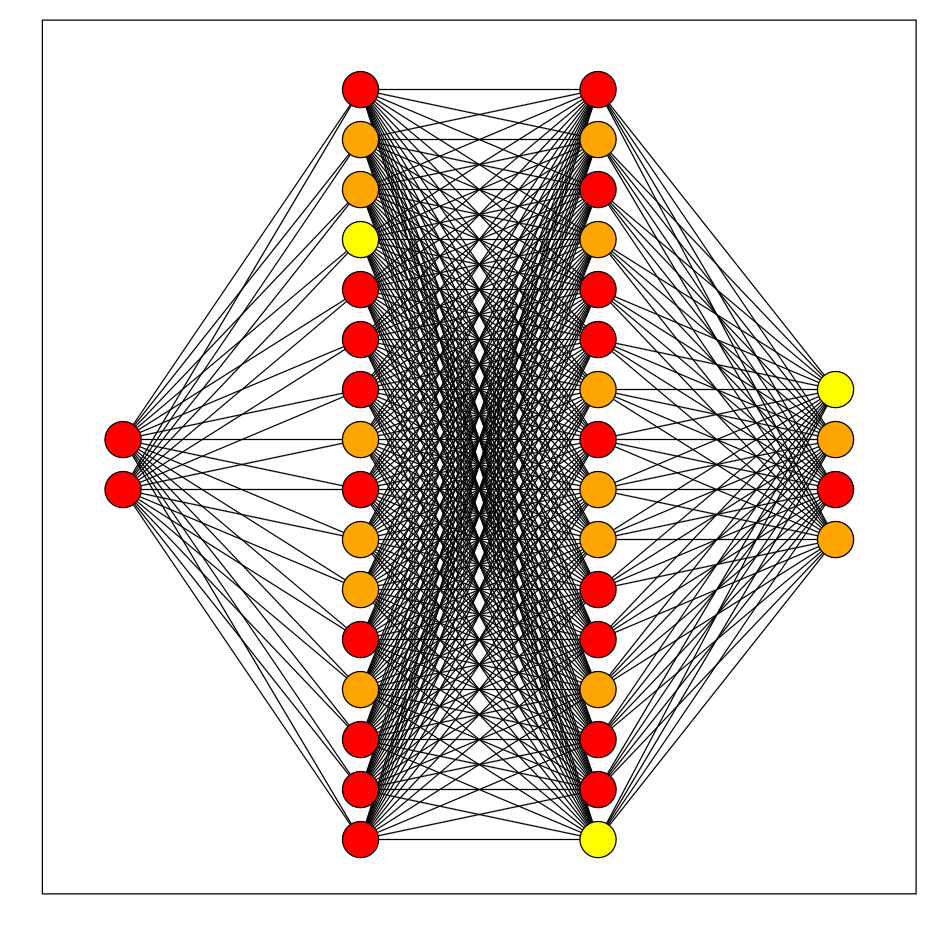
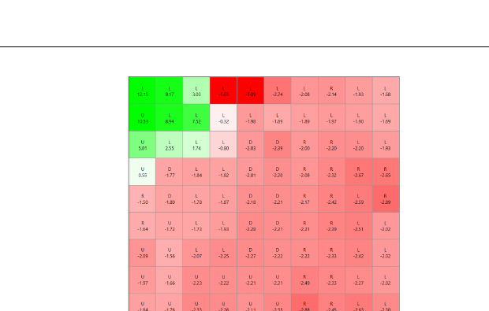
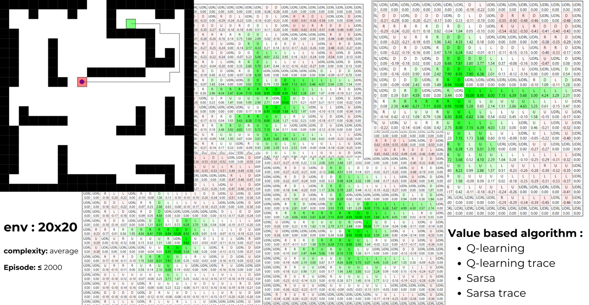
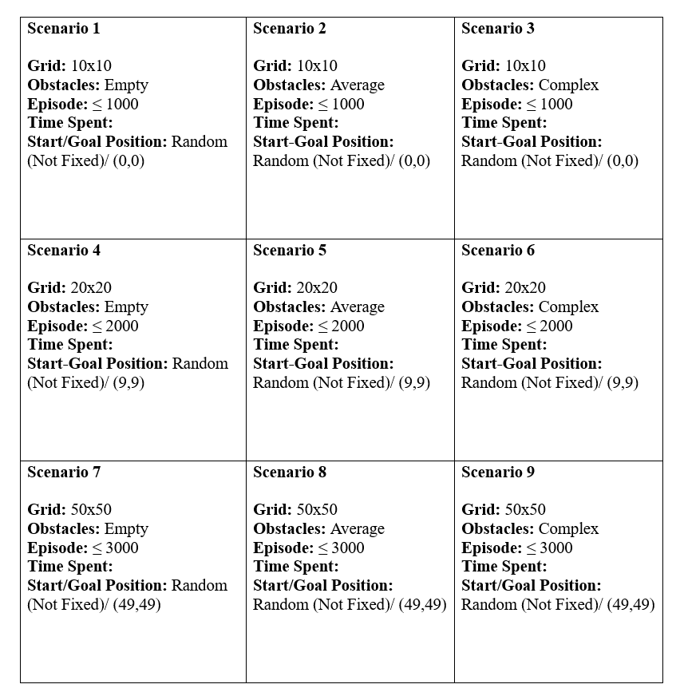
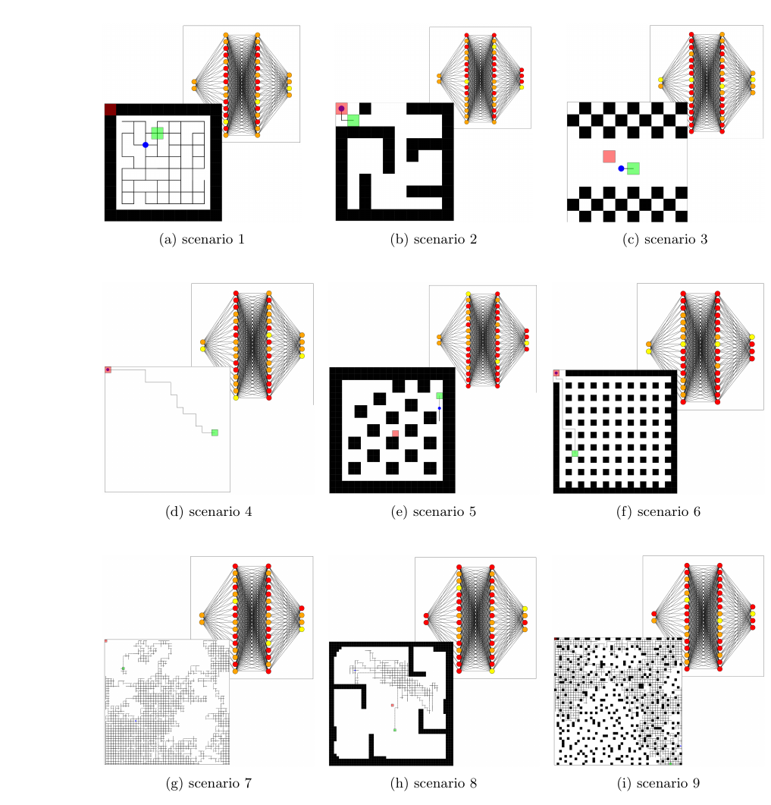
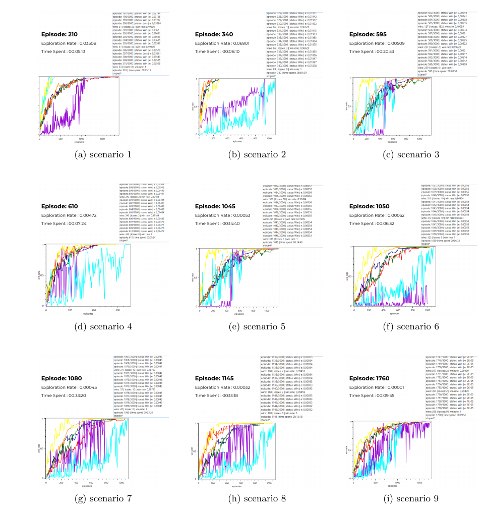
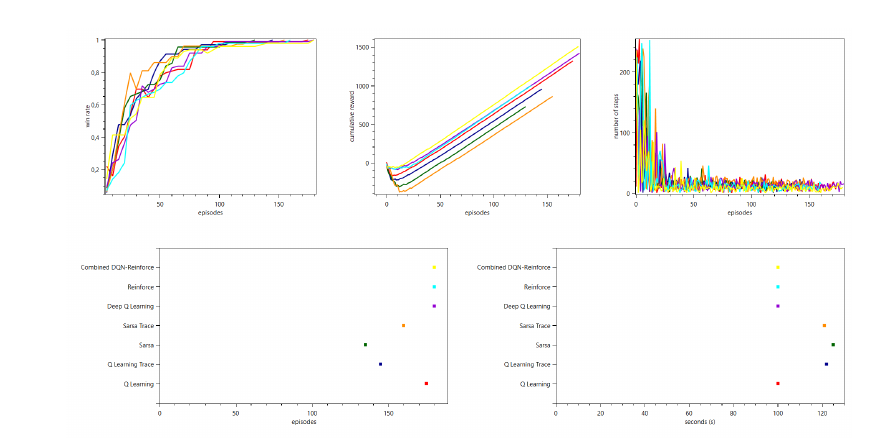

# Autonomous Mobile Robot Learning in Unknown Environments

### Reinforcement learning for mobile robot navigation: a combined DQN + REINFORCE approach

[-00629b)](conference/ICECET2022_Acceptance_Letter_ID1002.pdf)
[](conference/ICECET2022_Acceptance_Letter_ID1002.pdf)


**Naima Boukhiar** · **Mohammed Amine Mami**
Faculty of Exact and Applied Sciences, University of Oran 1 Ahmed Ben Bella, Oran, Algeria

Accepted as a full paper for **oral presentation** at the **International Conference on Electrical,
Computer, and Energy Technologies (ICECET 2022)**, July 20–22, 2022, Prague, Czech Republic.

| 📄 [Paper](paper/Autonomous_Mobile_Robot_Learning_Unknown_Environment.pdf) | ✉️ [Acceptance letter](conference/ICECET2022_Acceptance_Letter_ID1002.pdf) | 🤖 [Simulator (Windows build)](simulator/) | 📊 [Run log](results/run_index.jsonl) |
|---|---|---|---|

---

## Overview

A mobile robot has to reach a goal in a grid world it has never seen, while avoiding obstacles.
This project builds a **from-scratch reinforcement learning framework and simulator in C#**,
compares five classic RL algorithms against each other, and proposes a **hybrid
DQN + REINFORCE** agent that combines value-based and policy-based learning.

Across nine navigation scenarios (empty grids, mazes, checkerboards, dense obstacle fields;
10×10 up to 50×50 cells), the hybrid agent reaches the goal more consistently, with higher
cumulative reward and fewer steps than the individual algorithms.

## Contributions

- **A hybrid DQN + REINFORCE agent.** DQN selects actions and learns Q-values through a replay
  memory and a target network. REINFORCE updates the policy from the same transitions. Both
  share one neural network.
- **A side-by-side study of six algorithms** under identical hyperparameters: Q-learning,
  Q(λ) (Q-learning with eligibility traces), SARSA, SARSA(λ), DQN and REINFORCE, compared on
  win rate, cumulative reward, steps per episode, episodes to converge and training time.
- **A C# / WPF RL framework written from scratch**, including the neural network layers,
  activations and the Adam optimizer, a maze generator, a live Q-table view and live training
  charts (OxyPlot). C# was chosen for fine control over the code and an easy path to Unity
  and 3D robot simulation.

## Method

<p align="center">
  
  
  <br><em>Left: the Q-network (input = robot (x, y), two hidden layers of 16 ReLU neurons, 4 linear outputs, one per action). Right: the live Q-table view, where values turn from red (negative) to green (positive) as the agent learns.</em>
</p>

**Environment setup**

| Element | Setting |
|---|---|
| State | Robot position on a 10×10, 20×20 or 50×50 grid |
| Actions | Up, down, left, right |
| Reward | +1.0 on reaching the goal |
| Penalty | −1 each time the robot hits an obstacle |
| Episode | From the start cell until the goal is reached |

**Hyperparameters** (shared by every algorithm)

| Parameter | Value |
|---|---|
| Max iterations | 10,000 |
| Max episodes | 3,000 |
| Learning rate α | 0.01 |
| Discount factor γ | 0.90 |
| Exploration rate ε | 0.10 |
| Exploration decay | 0.995 |
| Batch size | 64 |
| Optimizer | Adam |

## Results

### Value-based and policy-based baselines

<p align="center">
  
  <br><em>Value-based agents (Q-learning, Q(λ), SARSA, SARSA(λ)) on a 20×20 maze: estimated values grow toward the goal.</em>
</p>

### Hybrid DQN + REINFORCE across nine scenarios

<p align="center">
  
</p>

<p align="center">
  
  <br><em>Nine scenarios: 10×10 (1–3), 20×20 (4–6) and 50×50 (7–9) grids, each empty, with average obstacles, or complex (maze, checkerboard, dense obstacles).</em>
</p>

<p align="center">
  
  <br><em>Win-rate curves per scenario. The yellow curve is the hybrid method.</em>
</p>

### Comparison of all methods

<p align="center">
  
  <br><em>Top: win rate, cumulative reward and steps per episode. Bottom: episodes to converge and training time per algorithm.</em>
</p>

The hybrid method keeps a win rate close to 1 across the experiments and collects the highest
cumulative reward with fewer steps per episode. DQN, REINFORCE and the hybrid converge to
similar results in some environments, but the hybrid stays closest to the optimal path.

### Sample runs from the simulator log

From [`results/run_index.jsonl`](results/run_index.jsonl) (seed 42, α = 0.1, γ = 0.9, ε = 0.1, λ = 0.8):

| Algorithm | Episodes until stop | Training time | Final win rate |
|---|---|---|---|
| Q-learning | 375 | 111 s | 1.00 |
| SARSA | 335 | 94 s | 1.00 |
| Q(λ) | 55 | 20 s | 1.00 |

Eligibility traces cut the number of episodes needed by roughly 7× in this run.

## Limitations

- All experiments are in simulated grid worlds. Performance on a physical robot with noisy
  sensors and moving obstacles has not been tested yet.
- The neural network and the hybrid update add computational cost, which matters on
  resource-constrained robots.
- Training can be long on large, complex maps.

## Running the simulator

The [`simulator/`](simulator/) folder contains the compiled Windows build.

1. Install the [.NET 7 Desktop Runtime](https://dotnet.microsoft.com/download/dotnet/7.0) (Windows only, since the UI uses WPF).
2. Run `simulator/RLmazeSimulation.exe`.
3. Pick a grid size, obstacle density and algorithm in the control panel, then start training.

## Repository contents

```
Autonomous_Mobile_Robot_RL_Navigation/
├── paper/        full paper (PDF) and first-page preview
├── conference/   ICECET 2022 acceptance letter (PDF + preview)
├── figures/      network, Q-table, simulations, scenarios, learning curves, comparison
├── simulator/    compiled C# / WPF simulator (.NET 7, Windows)
└── results/      run_index.jsonl, the simulator's log of training runs
```

## Related repositories

- [Towards_RealTime_Precision_Agriculture](https://github.com/naimabouk/Towards_RealTime_Precision_Agriculture): task-aware multi-modal decision framework (IEEE ISAIA 2026)
- [upmo-smart-agriculture](https://github.com/naimabouk/upmo-smart-agriculture): uncertainty-aware multi-objective optimization for smart agriculture (ACIT'2026)
- [hurudza-iot-telemetry](https://github.com/naimabouk/hurudza-iot-telemetry): ESP32 multi-sensor field node for the Hurudza agritech project

## Citation

```bibtex
@inproceedings{boukhiar2022autonomous,
  title     = {Autonomous Mobile Robot Learning in Unknown Environment},
  author    = {Boukhiar, Naima and Mami, Mohammed Amine},
  booktitle = {International Conference on Electrical, Computer, and Energy Technologies (ICECET)},
  address   = {Prague, Czech Republic},
  year      = {2022},
  note      = {Paper ID 1002}
}
```

## Contact

Naima Boukhiar, High School of Computer Science ESI · naima.boukhiar@univ-alger.dz
